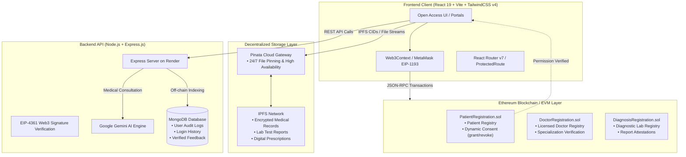

# 🩺 ArogyaBridge — Decentralized Electronic Health Record (EHR) System

[](https://arogya-bridge-project.vercel.app/)
[](https://arogyabridge-backend-api.onrender.com)
[](https://ethereum.org/)
[](https://web3js.org/)
[](https://ipfs.tech/)
[-61DAFB?style=for-the-badge&logo=react)](https://react.dev/)
[](https://tailwindcss.com/)
[](https://ai.google.dev/)

> **ArogyaBridge** is an enterprise-grade, decentralized electronic health record (EHR) management platform designed to empower patients with cryptographic sovereignty over their medical history while enabling licensed doctors and diagnostic laboratories to securely share, verify, and access clinical documents via **Ethereum Smart Contracts**, **Distributed IPFS Storage**, and **Google Gemini AI**.

---

## 🌐 Live Deployments & Open Access

* **Production Frontend:** [https://arogya-bridge-project.vercel.app/](https://arogya-bridge-project.vercel.app/)
* **Production Backend API:** [https://arogyabridge-backend-api.onrender.com](https://arogyabridge-backend-api.onrender.com)
* **GitHub Repository:** [https://github.com/Ramanand-tomar/ArogyaBridge-Project](https://github.com/Ramanand-tomar/ArogyaBridge-Project)

> [!NOTE]
> **Open Access Mode Enabled:** Visitors do **not** need MetaMask installed just to explore the platform, read clinical features, or test the interface. A Web3 wallet (MetaMask) is requested strictly when executing blockchain transactions, signing consent permissions, or performing passwordless cryptographic login.

---

## 📚 Table of Contents

- [🚀 Project Overview & Vision](#-project-overview--vision)
- [🎯 The Problem in Modern Healthcare](#-the-problem-in-modern-healthcare)
- [💡 The ArogyaBridge Solution](#-the-arogyabridge-solution)
- [🏗️ System Architecture](#️-system-architecture)
- [🛠️ Technologies Used](#️-technologies-used)
  - [Frontend Tier](#1-frontend-tier)
  - [Backend & Microservices Tier](#2-backend--microservices-tier)
  - [AI & Intelligence Tier](#3-ai--intelligence-tier)
- [⛓️ Blockchain Technology & Web3 Architecture](#️-blockchain-technology--web3-architecture)
  - [Ethereum Virtual Machine (EVM) Core](#1-ethereum-virtual-machine-evm-core)
  - [Smart Contract Ecosystem & Methodologies](#2-smart-contract-ecosystem--methodologies)
  - [Web3.js & Wallet Provider Layer (EIP-1193 & EIP-4361)](#3-web3js--wallet-provider-layer-eip-1193--eip-4361)
  - [Decentralized Storage Protocol (IPFS & Pinata)](#4-decentralized-storage-protocol-ipfs--pinata)
  - [Web3 Development & Testing Pipeline (Truffle & Ganache)](#5-web3-development--testing-pipeline-truffle--ganache)
- [🧩 Key Modules & Portals](#-key-modules--portals)
  - [1. Patient Portal](#1-patient-portal)
  - [2. Doctor Portal](#2-doctor-portal)
  - [3. Diagnostic Center Portal](#3-diagnostic-center-portal)
  - [4. Administrative & Analytics Panel](#4-administrative--analytics-panel)
  - [5. Interactive Feedback & Community Testimonials](#5-interactive-feedback--community-testimonials)
  - [6. AI Medical Consultation Chatbot](#6-ai-medical-consultation-chatbot)
- [🔐 Security & Compliance Framework](#-security--compliance-framework)
- [💻 Step-by-Step Local Setup Guide](#-step-by-step-local-setup-guide)
  - [Prerequisites](#prerequisites)
  - [1. Clone Repository](#1-clone-repository)
  - [2. Smart Contract Deployment (Truffle & Ganache)](#2-smart-contract-deployment-truffle--ganache)
  - [3. Backend Configuration & Execution](#3-backend-configuration--execution)
  - [4. Frontend Configuration & Execution](#4-frontend-configuration--execution)
- [📸 Platform Showcase](#-platform-showcase)
- [🔮 Future Roadmap](#-future-roadmap)
- [🤝 Contributing & License](#-contributing--license)

---

## 🚀 Project Overview & Vision

Modern healthcare systems suffer from fragmented electronic records trapped inside centralized hospital databases. Patients rarely own their records, paper prescriptions get lost or damaged, and unauthorized record tampering remains a persistent liability.

**ArogyaBridge** solves this by establishing a decentralized, patient-sovereign trust protocol:
1. **Zero Plaintext Credentials on the Public Ledger:** Smart contracts store verified identity hashes, wallet bindings, and permission mappings—never unencrypted passwords or diagnoses.
2. **Patient-Governed Dynamic Consent:** Patients can grant and revoke doctor viewing privileges in real time through cryptographically signed smart contract calls.
3. **Decentralized Document Pipelines:** Medical files, lab diagnostics, and digital prescriptions are pinned to IPFS, ensuring tamper-proof immutability with content-addressed hashes (CIDs).
4. **AI-Assisted Patient Understanding:** Integrated Google Gemini AI explains medical jargon, summarizes complex test metrics, and answers clinical FAQs.

---

## 🎯 The Problem in Modern Healthcare

* **Data Fragmentation:** Health records are scattered across independent clinics and diagnostic centers with no unified, patient-accessible timeline.
* **Lack of Patient Consent Sovereignty:** Patients have zero oversight over which entities access, share, or monetize their health information.
* **Prescription & Report Forgery:** Physical prescription slips and paper lab reports are easily forged or altered.
* **Centralized Single Points of Failure:** Centralized hospital servers are prime targets for ransomware, data leaks, and catastrophic outages.
* **Audit Trail Deficits:** Lack of immutable, verifiable audit trails for regulatory compliance (HIPAA, GDPR).

---

## 💡 The ArogyaBridge Solution

| Traditional Healthcare IT | ArogyaBridge Decentralized Protocol |
| :--- | :--- |
| Records siloed in proprietary hospital databases | Sovereign patient records accessible across providers with cryptographic consent |
| Vulnerable to centralized database leaks and attacks | Distributed, content-addressed storage on IPFS with zero single point of failure |
| Paper-based, forgeable prescriptions | Tamper-proof digital prescriptions cryptographically anchored to smart contracts |
| Fragile username/password authentication | Passwordless Web3 Sign-In (EIP-4361) using hardware/browser wallets |
| Ambiguous access histories | Immutable, transparent on-chain event logs (`PermissionGranted`, `PermissionRevoked`) |

---

## 🏗️ System Architecture



---

## 🛠️ Technologies Used

### 1. Frontend Tier
* **React 19 (`react` 19.0, `react-dom` 19.0):** Leverages modern React concurrent rendering and fast reconciliation for non-blocking UI interactions across health portals.
* **Vite 7 (`vite` 6.2):** Next-generation lightning-fast frontend dev server with Hot Module Replacement (HMR) and optimized Rollup tree-shaking for production builds.
* **Tailwind CSS v4 (`@tailwindcss/postcss`, `tailwindcss` 4.0):** Modern utility engine with custom design tokens, accessible `:focus-visible` outlines, reduced-motion compliance, and high-performance zero-runtime CSS.
* **Medical Design System:** Clean clinical aesthetic engineered in light slate (`#f8fafc`), high-contrast typography, interactive star rating selectors, status badges, and subtle ambient light gradients.
* **React Router v7 (`react-router-dom` 7.2):** Declarative client-side routing with specialized `<ProtectedRoute>` guards to verify session states and handle unauthenticated access gracefully.
* **Recharts (`recharts` 3.0):** Responsive SVG charting library rendering real-time distribution charts and historical health metrics in the administrative analytics dashboard.
* **React Hot Toast (`react-hot-toast` 2.5):** Deduplicated, non-blocking notification alerts replacing intrusive native `alert()` popups with toast queues.
* **PDF-Lib & File-Saver (`pdf-lib` 1.17, `file-saver` 2.0):** Client-side PDF generation, cryptographic stamping, and automatic browser downloads for digital prescriptions.
* **React Icons (`react-icons` 5.5):** High-resolution, accessible SVG iconography covering Feather, FontAwesome, and Heroicons.

### 2. Backend & Microservices Tier
* **Node.js (v20+ LTS):** High-concurrency, event-driven JavaScript engine running backend microservices.
* **Express.js (`express` 4.21):** Fast, minimalist REST API framework with modular controllers, input validation middleware, and secure routing.
* **MongoDB & Mongoose (`mongoose` 8.12):** NoSQL document database and Object Data Modeling (ODM) layer managing off-chain audit logs, login histories, and patient community feedback.
* **Multer (`multer` 1.4):** Streaming multipart/form-data middleware handling medical report and lab file buffer ingestion before IPFS pinning.
* **Bcrypt (`bcrypt` 5.1):** Secure password hashing with automated salt rounds for administrative personnel authentication.
* **CORS & Dotenv (`cors` 2.8, `dotenv` 16.4):** Cross-Origin Resource Sharing security policy configuration and environment secret management.

### 3. AI & Intelligence Tier
* **Google Gemini AI Engine (`@google/genai`):** Powered by Google's latest multimodal models for real-time medical consultation, lab result jargon decoding, symptom explanations, and 24/7 intelligent patient assistance.

---

## ⛓️ Blockchain Technology & Web3 Architecture

ArogyaBridge implements an enterprise-grade decentralized electronic health record framework built on the **Ethereum Virtual Machine (EVM)**, cryptographic wallet verification, and decentralized peer-to-peer storage.

| Layer | Technology | Specification / Standard | Architectural Role |
| :--- | :--- | :--- | :--- |
| **Virtual Machine** | Ethereum Virtual Machine (EVM) | London / Shanghai EVM Target | Deterministic smart contract execution |
| **Smart Contracts** | Solidity | `^0.8.19` (ABIEncoderV2, Custom Structs) | Identity registry, dynamic consent matrix, and audit logging |
| **Client Web3 Bridge** | Web3.js | `v4.16.0` (Modular Provider Architecture) | JSON-RPC contract invocation, event filters, account balance queries |
| **Wallet Protocol** | MetaMask / Web3 Wallets | EIP-1193 Standard Provider | Secure key custody, transaction signing, and network switching |
| **Authentication** | Sign-In with Ethereum | EIP-4361 Standard | Replay-resistant cryptographic challenge-response authentication |
| **Decentralized Storage**| IPFS (InterPlanetary File System) | Content-Addressed Hash (CIDv0 / CIDv1) | Tamper-proof, immutable distributed medical record storage |
| **IPFS Pinning Service**| Pinata Cloud API | Dedicated Gateway & REST Pinning | 24/7 high-availability file persistence and edge caching |
| **Build & Migration** | Truffle Suite | `v5.11+` | Compilation, artifact generation, and deployment pipelines |
| **Local Blockchain** | Ganache | Port `7545`, Chain ID `5777` | Zero-latency local EVM testnet for deterministic contract debugging |

### 1. Ethereum Virtual Machine (EVM) Core
The EVM acts as the decentralized source of truth for ArogyaBridge:
* **State Immutability:** Once an identity or permission is registered on-chain, it cannot be altered by third parties or malicious actors.
* **Deterministic Execution:** Smart contract rules execute identically across all nodes without centralized intermediaries.
* **Public Cryptographic Verification:** Allows patients and doctors to verify consent states independently using public EVM state queries.

### 2. Smart Contract Ecosystem & Methodologies

The core smart contract logic resides in [`frontend/contracts/`](file:///c:/Users/raman/OneDrive/Desktop/ArogyaBridge/frontend/contracts):

#### A. `PatientRegistration.sol`
* **Purpose:** Manages patient sovereign identities and the dynamic consent delegation matrix.
* **Key Data Structures:**
  * `struct Patient`: Stores `{ address walletAddress, string name, string dateOfBirth, string gender, string bloodGroup, string homeAddress, string email, string hhNumber }`.
  * `struct PatientList`: Stores `{ string patient_number, string patient_name }`.
  * `mapping(string => bool) public isPatientRegistered`: O(1) existence checks by Health Holding (HH) Number.
  * `mapping(string => Patient) public patients`: Direct lookup of on-chain patient profiles.
  * `mapping(address => string) public walletToPatientHH`: Reverse lookup linking wallet address to HH number.
  * `mapping(string => mapping(string => bool)) public doctorPermissions`: Double-mapping `doctorPermissions[patientNumber][doctorNumber]` storing real-time viewing permissions.
  * `mapping(string => PatientList[]) private Dpermission`: List of patients who have actively granted permission to a given doctor.
* **Core Functions:**
  * `registerPatient(...)`: Registers a patient profile, binds the caller's wallet address, and emits `PatientRegistered`.
  * `grantPermission(string _patientNumber, string _doctorNumber, string _patientName)`: Protected by modifier `onlyRegisteredPatient` and caller validation (`patients[_patientNumber].walletAddress == msg.sender`), permitting the designated doctor to view records.
  * `revokePermission(string _patientNumber, string _doctorNumber)`: Instantly revokes a doctor's viewing access and cleans up the active patient list.
  * `isPermissionGranted(string _patientNumber, string _doctorNumber)`: Returns a boolean confirmation of whether access is active.
* **Events:**
  * `event PatientRegistered(string indexed hhNumber, string name, address indexed walletAddress)`
  * `event PermissionGranted(string indexed patientNumber, string indexed doctorNumber)`
  * `event PermissionRevoked(string indexed patientNumber, string indexed doctorNumber)`

#### B. `DoctorRegistration.sol`
* **Purpose:** On-chain registry for licensed physicians, credentials, and hospital affiliations.
* **Key Data Structures:**
  * `struct Doctor`: Stores `{ address walletAddress, string doctorName, string hospitalName, string dateOfBirth, string gender, string email, string hhNumber, string specialization, string department, string designation, string workExperience }`.
  * `mapping(string => address) private doctorAddresses`: Tracks primary wallet bound to medical registration number.
  * `mapping(string => Doctor) private doctors`: Doctor profile registry.
  * `mapping(address => string) public walletToDoctorHH`: Reverse lookup for doctor wallet addresses.
* **Core Functions:**
  * `registerDoctor(...)`: Validates registration number uniqueness, stores doctor profile, binds wallet, and emits `DoctorRegistered`.
  * `getAllDoctors()`: Returns batch arrays of registered doctors for public directory verification.
  * `getDoctorCount()`: Returns total count of certified doctors on the network.
* **Events:**
  * `event DoctorRegistered(string indexed hhNumber, string doctorName, address indexed walletAddress)`

#### C. `DiagnosisRegistration.sol`
* **Purpose:** Accreditation registry for diagnostic centers and clinical pathology laboratories.
* **Key Data Structures:**
  * `struct Diagnostic`: Stores `{ address walletAddress, string diagnosticName, string hospitalName, string diagnosticLocation, string email, string hhNumber }`.
  * `mapping(string => address) private diagnosticAddresses`: Diagnostic center wallet address mapping.
  * `mapping(string => Diagnostic) private diagnostics`: Diagnostic facility profiles.
  * `mapping(address => string) public walletToDiagnosticHH`: Reverse lookup for diagnostic facility wallets.
* **Core Functions:**
  * `registerDiagnostic(...)`: Registers a certified laboratory facility, binds wallet address, and emits `DiagnosticRegistered`.
  * `getAllDiagnostics()`: Returns list of accredited diagnostic centers.
  * `getDiagnosticCount()`: Returns total count of certified diagnostic centers.
* **Events:**
  * `event DiagnosticRegistered(string indexed hhNumber, string diagnosticName, address indexed walletAddress)`

### 3. Web3.js & Wallet Provider Layer (EIP-1193 & EIP-4361)
* **Web3.js v4.16:** Facilitates asynchronous contract instantiation via JSON-RPC, automatic ABI decoding, transaction nonce management, and gas calculation.
* **MetaMask Integration (EIP-1193):** Interacts with `window.ethereum` to request accounts (`eth_requestAccounts`), listen to account changes (`accountsChanged`), and monitor active chain switches (`chainChanged`).
* **Open Access Mode Architecture:** ArogyaBridge detects whether `window.ethereum` is injected. If missing, the application defaults to an open read-only fallback mode, allowing prospective patients to inspect portals and view documentation without triggering blocking wallet extension crashes.
* **Sign-In with Ethereum (EIP-4361):** Replaces insecure password authentication with cryptographically signed challenge messages, verified off-chain to authenticate users without exposing private keys.

### 4. Decentralized Storage Protocol (IPFS & Pinata)
* **InterPlanetary File System (IPFS):** Large binary healthcare files (MRI scans, CT scans, blood test reports, and PDF prescriptions) are never stored directly on the blockchain due to block size limits and excessive gas costs. Instead, files are chunked, encrypted, and addressed by their cryptographic Content Identifier (CID).
* **Pinata Cloud Dedicated Gateway:** Serves pinned IPFS files through a secure, high-speed CDN gateway authenticated via JWT tokens, ensuring that authorized patients and doctors retrieve medical files in milliseconds without network timeouts.
* **Tamper-Proof Guarantee:** If any byte of an IPFS medical report is modified, its resulting hash changes completely, immediately alerting the system to unauthorized alterations.

### 5. Web3 Development & Testing Pipeline (Truffle & Ganache)
* **Truffle Suite:** Handles automated compilation of Solidity sources, optimizes bytecode via the solc optimizer (200 runs), and runs scripted migration artifacts (`1_initial_migration.js`, `2_deploy_contracts.js`) that output typed ABIs to `frontend/src/contracts/`.
* **Ganache:** Local virtual blockchain supporting 10 pre-funded test accounts (100 ETH each), enabling comprehensive local end-to-end testing of dynamic permission granting and revocation without incurring real mainnet gas fees.

---

## 🧩 Key Modules & Portals

### 1. Patient Portal
* **Decentralized Profile:** View verified on-chain patient credentials (HH Number, Blood Group, DOB, Address).
* **IPFS Document Pinning:** Securely upload past medical records, discharge summaries, and lab reports directly to IPFS.
* **Dynamic Consent Delegation:** Grant or revoke doctor viewing access in real time via smart contract transactions.
* **Prescription Vault:** Access digital prescriptions written by authenticated doctors, with doctor verification details and IPFS download links.
* **Diagnostic Report Center:** Review official diagnostic laboratory findings and pathology tests.

### 2. Doctor Portal
* **Practitioner Verification:** Review on-chain practitioner credentials, department, designation, and clinical experience.
* **Patient Roster:** Look up patients, verify whether active consent permissions have been granted on-chain, and inspect authorized medical records.
* **Digital Prescription Generation:** Issue official prescriptions stored in the decentralized registry and downloadable as PDF documents.

### 3. Diagnostic Center Portal
* **Facility Profile:** Verify diagnostic facility credentials, registered hospital affiliation, and contact details.
* **Generate Lab Reports:** Issue diagnostic evaluations by uploading pathology or radiology files to IPFS and anchoring the resulting CID on-chain with patient HH numbers.

### 4. Administrative & Analytics Panel
* **System Distribution Analytics:** Recharts bar charts visualizing ratios of patients, doctors, and diagnostic centers.
* **Real-Time Metric Cards:** Track counts of IPFS files, digital prescriptions, lab reports, and user sessions.
* **Audit Trail Tables:** Tabular records of patient registries, doctor specializations, user login sessions, and pinned IPFS documents.

### 5. Interactive Feedback & Community Testimonials
* **Multi-Attribute Feedback Form:** 5-star interactive rating, feedback topic selector (`Patient Experience`, `Clinical Workflow`, `Security & Privacy`, `Feature Suggestion`), role selector (`Patient`, `Doctor`, `Lab`), and character-limited commentary.
* **Dynamic Testimonials Showcase:** Responsive carousel displaying authentic community feedback fetched from `/api/feedback`, complete with star ratings, verified role pills, and smooth chevron navigation.

### 6. AI Medical Consultation Chatbot
* **Instant Healthcare Guidance:** Floating interactive AI assistant powered by Google Gemini AI to help users navigate medical definitions, symptoms, and platform queries.

---

## 🔐 Security & Compliance Framework

1. **Zero Plaintext Credentials On-Chain:** Passwords and plaintext medical diagnoses are strictly forbidden from public contract state.
2. **Access Control Modifiers:** Smart contract write functions are guarded with `onlyRegisteredPatient`, `require(isPatientRegistered[...])`, and explicit permission checks (`doctorPermissions[patient][doctor] == true`).
3. **Cryptographic Signatures (EIP-4361):** Authentication relies on signing challenges with the user's private key via MetaMask, eliminating traditional credential sniffing.
4. **Content-Addressed Immutability:** Any tampering with an IPFS-stored medical report alters its cryptographic hash (CID), immediately invalidating forged reports.
5. **Auditable Event Streams:** Every administrative action, consent grant, and report creation emits a Solidity event on the Ethereum blockchain for tamper-proof regulatory auditing.

---

## 💻 Step-by-Step Local Setup Guide

### Prerequisites
* [Node.js (v18 or v20 LTS)](https://nodejs.org/)
* [Git](https://git-scm.com/)
* [Truffle Suite](https://trufflesuite.com/): `npm install -g truffle`
* [Ganache](https://trufflesuite.com/ganache/): Local blockchain GUI or CLI (`npm install -g ganache`)
* [MetaMask Browser Extension](https://metamask.io/)
* [MongoDB](https://www.mongodb.com/try/download/community) or MongoDB Atlas connection string
* [Pinata Account](https://app.pinata.cloud/) for IPFS gateway JWT credentials
* [Google Gemini API Key](https://aistudio.google.com/)

---

### 1. Clone Repository

```bash
git clone https://github.com/Ramanand-tomar/ArogyaBridge-Project.git
cd ArogyaBridge-Project
```

---

### 2. Smart Contract Deployment (Truffle & Ganache)

1. Launch **Ganache** (create a Quickstart or Custom workspace running on port `7545` with Network ID `5777`).
2. Open terminal in the project root and navigate to the contract directory:
   ```bash
   cd frontend
   truffle compile
   truffle migrate --reset
   ```
3. Copy the deployed contract addresses displayed in the terminal for:
   * `PatientRegistration`
   * `DoctorRegistration`
   * `DiagnosisRegistration`
4. Update the contract addresses in `frontend/src/context/Web3Context.jsx`.

---

### 3. Backend Configuration & Execution

1. Navigate to the server directory:
   ```bash
   cd ../server
   npm install
   ```
2. Create a `.env` file in `server/`:
   ```env
   PORT=5000
   MONGODB_URL=mongodb+srv://<username>:<password>@cluster.mongodb.net/arogyabridge?retryWrites=true&w=majority
   GEMINI_API_KEY=your_gemini_api_key_here
   JWT_SECRET=your_jwt_secret_key_here
   ```
3. Start the backend server:
   ```bash
   node server.js
   # or with nodemon for active development:
   npx nodemon server.js
   ```
   *Server will run at `http://localhost:5000`.*

---

### 4. Frontend Configuration & Execution

1. Navigate to the frontend directory:
   ```bash
   cd ../frontend
   npm install
   ```
2. Create or verify `.env` in `frontend/`:
   ```env
   VITE_BACKEND_URL=http://localhost:5000
   VITE_PINATA_JWT=your_pinata_jwt_token_here
   VITE_PINATA_GATEWAY=your_gateway.mypinata.cloud
   ```
3. Start the Vite development server:
   ```bash
   npm run dev
   ```
   *Frontend will launch at `http://localhost:5173`.*

---

## 📸 Platform Showcase

| Module | Interface Preview |
| :--- | :--- |
| **Hero & Open Access** |  |
| **Interactive Testimonials** |  |
| **Patient Registration** |  |
| **Web3 Secure Login** |  |
| **Patient Dashboard** |  |
| **Doctor Consent Delegation** |  |
| **Digital Prescriptions** |  |
| **Diagnostic Center Portal** |  |
| **Administrative Analytics** |  |
| **AI Medical Chatbot** |  |

---

## 🔮 Future Roadmap

- [ ] **Layer-2 Gas Optimization:** Porting contract logic to Polygon or Arbitrum to reduce transaction fees to fractions of a cent.
- [ ] **End-to-End Client-Side Record Encryption:** Integrating Lit Protocol or Web3 RSA public-key envelopes before pinning files to IPFS.
- [ ] **Automated Health Insurance Smart Contracts:** Instant micro-claim adjudications through decentralized diagnostic verification.
- [ ] **Decentralized Identifier (DID) & Verifiable Credentials (VC):** W3C standard compliance for cross-border medical portability.
- [ ] **Wearable Health Device Ingestion:** Real-time biometric syncing (heart rate, blood glucose) with verifiable data proofs.

---

## 🤝 Contributing & License

Contributions, bug reports, and pull requests are warmly welcomed!

1. Fork the repository
2. Create your feature branch (`git checkout -b feature/clinical-enhancement`)
3. Commit your changes (`git commit -m 'feat: add automated diagnostic verification'`)
4. Push to the branch (`git push origin feature/clinical-enhancement`)
5. Open a Pull Request

### Author & Maintainer
* **Ramanand Tomar**
* **Email:** [ramanandtomar1234@gmail.com](mailto:ramanandtomar1234@gmail.com)
* **LinkedIn:** [https://www.linkedin.com/in/ramanand-tomar-478528342/](https://www.linkedin.com/in/ramanand-tomar-478528342/)
* **Project Repository:** [ArogyaBridge-Project](https://github.com/Ramanand-tomar/ArogyaBridge-Project)

---
*Developed with ❤️ for transparent, secure, and patient-sovereign healthcare worldwide.*
